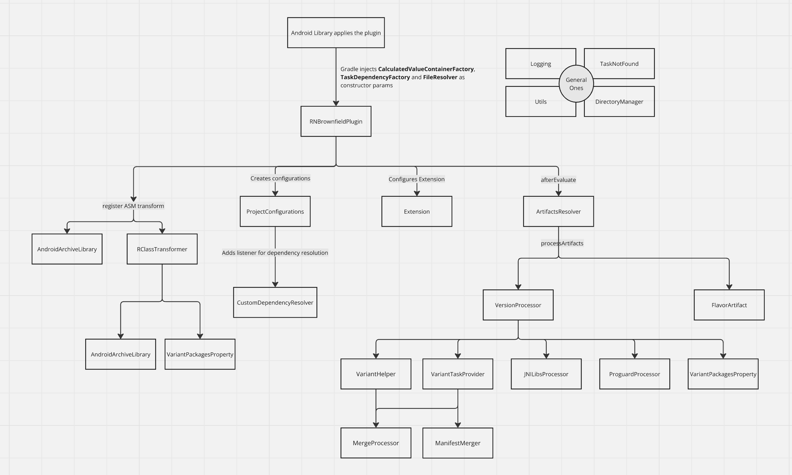

# React Native Brownfield Gradle Plugin


This plugin helps you convert your react-native brownfield implementation into a fat Aar.

## Installation

### From Remote

Use the latest version published on Maven Central.

To your top level `build.gradle` add

```diff
buildscript {
    repositories {
        google()
        mavenCentral()
    }
    dependencies {
        classpath("com.android.tools.build:gradle")
        classpath("com.facebook.react:react-native-gradle-plugin")
        classpath("org.jetbrains.kotlin:kotlin-gradle-plugin")
+       classpath("com.callstack.react:brownfield-gradle-plugin:<latest-version>")
    }
}
```

To your brownfield project level `build.gradle.kts` add

```diff
 plugins {
     id("com.android.library")
     id("org.jetbrains.kotlin.android")
+    id("com.callstack.react.brownfield")
     `maven-publish`
     id("com.facebook.react")
 }
react {
     autolinkLibrariesWithApp()
 }

 val appProject = project(":app")
```

### From Local

- From the root of this repository, run `yarn brownfield:plugin:publish:local` and it will publish the plugin to your local maven

To your top level `build.gradle` add

```diff
buildscript {
    repositories {
+       mavenLocal()
        google()
        mavenCentral()
    }
    dependencies {
        classpath("com.android.tools.build:gradle")
        classpath("com.facebook.react:react-native-gradle-plugin")
        classpath("org.jetbrains.kotlin:kotlin-gradle-plugin")
+       classpath("com.callstack.react:brownfield-gradle-plugin:<latest-version>-SNAPSHOT")
    }
}
```

To your brownfield project level `build.gradle.kts` add

```diff
 plugins {
     id("com.android.library")
     id("org.jetbrains.kotlin.android")
+    id("com.callstack.react.brownfield")
     `maven-publish`
     id("com.facebook.react")
 }
react {
     autolinkLibrariesWithApp()
 }

 val appProject = project(":app")
```

### From `node_modules` Source

The Maven dependency is the recommended default because it uses the prebuilt plugin and is faster.
Use this source-based setup only when you need to patch the Brownfield Gradle Plugin locally. See the [Android integration docs](../../docs/docs/docs/getting-started/android.mdx#advanced-load-the-plugin-from-node-modules) for details.

Add this to the top of `android/settings.gradle.kts`:

```kotlin
pluginManagement {
    includeBuild(
        File(
            providers.exec {
                workingDir(rootDir)
                commandLine("node", "--print", "require.resolve('@callstack/react-native-brownfield/package.json')")
            }.standardOutput.asText.get().trim()
        ).parentFile.resolve("gradle-plugin/brownfield")
    )
    repositories {
        google()
        mavenCentral()
        gradlePluginPortal()
    }
}
```

For standard React Native app layouts, this shorter form also works:

```kotlin
pluginManagement {
    includeBuild("../node_modules/@callstack/react-native-brownfield/gradle-plugin/brownfield")
    repositories {
        google()
        mavenCentral()
        gradlePluginPortal()
    }
}
```

Then remove the Maven classpath dependency:

```diff
- classpath("com.callstack.react:brownfield-gradle-plugin:1.1.0")
```

Keep using `id("com.callstack.react.brownfield")` in your brownfield Android library module.

## API Usage

- **About Dependencies**

You can `embed` dependencies in your Aar by using this configuration. It is as simple as doing the following:

```kts
dependencies {
    embed("com.facebook.react:hermes-android:0.77.0")
    embed("com.google.android.material:material:0.7.0")
}
```

The `embed` configuration is useful, only if you want to bundle these dependencies within your fat Aar. Be careful that it can result in clashes between the bundled version of a dependency and the version used by the App. What this means is consider you embedded dependencyA with version 0.0.1 and the native App which will use your Aar also uses dependencyA but with version 0.0.2, it will produce a clash.

If you are sure that the native App will never use the dependency you have embedded within your Aar, you should be fine with using `embed`. But if you know before hand that those dependencies can be used by the native App then it's better for you to avoid embedding and instead use either of `implementation` and `compileOnly` configuration and surface it with the native team that the Aar relies on the App to provide these dependencies.

When you use `implementation` or `compileOnly`, this plugin does not bundle those dependencies in your Aar and instead just uses them to provide for the compile time. Using these configuration is as simple as:

```kts
dependencies {
    implementation("com.facebook.react:hermes-android:0.77.0")
    compileOnly("com.google.android.material:material:0.7.0")
}
```

There is one more configuration called `api` and it is often the one you should use. The reason is that this configuration tells gradle to provide for these dependencies in compile time while developing and also provide these when the generated Aar is consumed by the native App. For the latter, you will need to use it in combination with `pom.xml` as the latter will only work if you have dependencies marked with `api` listed in `pom.xml`.

```kts
    api("com.facebook.react:react-android:0.77.0")
    api("com.facebook.react:hermes-android:0.77.0")
    implementation("com.google.android.material:material:0.7.0")
```

In react-native brownfield, when we want to use `react-android` and `hermes-android` in the Aar, we can use `api` to allow us developing and also tell gradle to provide these dependencies and it's transitive ones as well, using `pom.xml`. If the native App uses one of the transitive dependency say `javax.inject`, gradle will automatically pick the highest version. This is often the ideal usage scenario where we don't want the native App team to worry about react-native's dependencies and transitive dependencies.

<hr/>

We can use `exclude` to not embed a nested dependency:

```kts
dependencies {
    embed("com.facebook.fbjni:fbjni:0.4.0") {
        exclude("com.facebook.soloader")
    }
}
```

<hr/>

The published POM and `module.json` follow the brownfield module's Gradle exclude rules. Put the exclude in the brownfield module's `build.gradle.kts`, for example when two libraries ship the same classes under different artifacts:

```kts
configurations.all {
    exclude(group = "com.caverock", module = "androidsvg")
}
```

The excluded dependency is left out of the published files, and is written as an exclusion on every published dependency, so the host app doesn't get it through one of them either. Use this instead of a custom task that edits the published files: the plugin rewrites them after Gradle generates them, so an earlier edit would be lost.

Only `exclude` rules on the `implementation`, `api`, `runtimeOnly` and `embed` configurations count. These are not read:

- excludes in `:app`: they describe the standalone React Native app, which may leave out things the host app needs
- excludes on a variant's configuration (`debugRuntimeClasspath`): every variant publishes the same list
- excludes on a single dependency (`implementation("x") { exclude(...) }`): they only apply under that dependency
- `resolutionStrategy` substitutions and capability rules

On Expo, prebuild regenerates the brownfield module, so list the dependencies in `brownfield.config.json` under `android.expo.excludeDependencies` (or under `android.excludeDependencies` in the plugin's options in `app.json`), as `group:module` or `group`. Prebuild writes them into the module as the `configurations.all` block above.

<hr/>
<br/>

**Expo Support**

The plugin supports Expo projects out of the box. Publishing the AAR to Maven Local will also publish the Expo dependencies to Maven Local so that they can be resolved when building the brownfield app.

<hr/>
<br/>

**Dynamic libs**

The AAR contains two kinds of native libs (`.so` files):

- the app module's own libs: `libappmodules.so` and `libreact_codegen_*.so`
- the libs of every library you embed

The `.so` files of Maven dependencies stay out of the AAR. The host app gets them through the AAR's POM, together with the rest of those libraries. Embedding them too would give the host two copies and fail its build. If you set `experimentalIncludeTransitiveDependencies = false`, the POM doesn't list those dependencies, so the host app must declare them itself. The same goes for any dependency the POM can't list: one with no version (managed by a BOM) or a dynamic version, one declared only for a flavor or build type, or one declared only in the app module. The host app needs that library's classes as well, so it has to declare the library either way, and that also brings its `.so` files. A `.so` from a local file dependency has no Maven artifact the host could declare; add it to `dynamicLibs`.

The AAR only has the ABIs (CPU architectures) your app module builds. If the app module uses `abiFilters`, ABIs it leaves out are dropped from the embedded libraries too. A device would otherwise pick an ABI folder that has no `libappmodules.so`, and the app would crash.

`useStrippedSoFiles` (default `true`) picks which copy the plugin starts from: the app module's stripped output or its unstripped output. It does not change which libs are embedded. AGP still runs its own strip step on the AAR's native libs during packaging.

To change the set:

- `dynamicLibs` adds libs, by exact file name. Use it for a `.so` the host app cannot get any other way: one your app module builds or ships itself (for example from `app/src/main/jniLibs`), or one from a dependency the published AAR does not declare.
- `ignoreEmbeddedLibs` keeps libs out. A lib is left out when its name contains an entry. It never removes `libappmodules.so` or `libreact_codegen_*.so`. It does win over `dynamicLibs`, and the build warns when that happens.

```kts
reactBrownfield {
    dynamicLibs = listOf("libmy-prebuilt.so")
    ignoreEmbeddedLibs = listOf("libdatadog-ndk.so")
}
```

If the host app crashes with `dlopen failed: library "libX.so" not found`, open `<brownfield module>/build/reports/brownfield/<variant>/skipped-so.txt`. It lists every `.so` that was left out of the AAR and why. The build also prints a `Brownfield: left … out of the AAR` line, but only when that task runs, not when Gradle reuses a cached result. If the missing lib is there and the host can't get it from a Maven dependency, add it to `dynamicLibs`.

<hr/>

**Flavored Android Builds**

To use product flavors and dimensions in your brownfield module, define them as usual:

```kts
    flavorDimensions += "env"

    productFlavors {
        create("prod") {
            dimension = "env"
        }
        create("dev") {
            dimension = "env"
        }
    }
```

This lets you run tasks like `gradle :brownfieldlib:assembleDevRelease`. However, once you add a flavor and dimension to the brownfield module, you must ensure the same flavor and dimension are defined in the `:app` module (your React Native app). This is required so the `brownfield-gradle-plugin` can correctly look up tasks for JavaScript bundling, Expo resources, and native binaries.

If there is a flavor mismatch, the build will fail. If your `:app` module defines multiple flavors, that is fine. You only need to ensure that every flavor used in the brownfield module also exists in the app module.

## Tooling

- We are using `ktlint` and `detekt` for formatting and linting
- You can run `./brownfield/gradlew -p brownfield detekt ktlintFormat` to auto-format and detect linting issues, or use the root workspace script `yarn run gradle-plugin:lint`
- Maintainers should use [PUBLISHING.md](./PUBLISHING.md) for the release workflow, release notes generation, and Maven Central publication process

## Architecture

Below is a flow diagram of how the files are being used in this gradle plugin from an overview:


